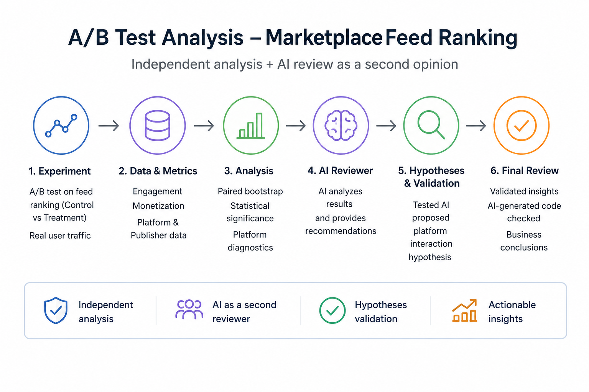

# A/B Test Analysis — Marketplace Feed Ranking

This project evaluates an A/B experiment that changed the ordering of paid and organic elements in a content feed.

- **Group A:** organic content shown before paid elements
- **Group B:** paid elements moved higher in the feed

The business goal was to determine whether the new ranking improves monetization without causing unacceptable deterioration in user engagement.

The **core A/B test analysis was completed independently in Python before AI was introduced**.  
AI was added afterwards as a second analytical reviewer to compare its interpretation with the original analyst conclusions, test the follow-up hypotheses it proposed, and evaluate how much methodological supervision AI-generated analytical code required.



## Reports

- **[Original A/B test report](./AB_test_Marketpele_Olga_Genova.pdf)**
- **[Final AI review](./outputs/final_ai_review.md)**
- **[README before the AI extension](./outputs/README_beforeAIadded.md)**

## Project structure

```text
.
├── 01_overall_ab_test.ipynb
├── 02_platform_diagnostics.ipynb
├── 03_platform_interaction.ipynb
├── AB_test_Marketpele_Olga_Genova.pdf
├── ai/
│   ├── reviewer_instructions.md
│   ├── run_review.md
│   ├── diagnostic_reviewer_instructions.md
│   ├── run_diagnostic_review.md
│   ├── platform_interaction_instructions.md
│   ├── run_platform_interaction.md
│   ├── final_reviewer_instructions.md
│   └── run_final_review.md
├── outputs/
│   ├── overall_results.json
│   ├── diagnostic_results.json
│   ├── platform_interaction_results.json
│   ├── ai_review.md
│   ├── diagnostic_ai_review.md
│   ├── final_ai_review.md
│   └── README_beforeAIadded.md
├── csv/
│   └── marketpele_ab_test_data_set.csv
└── svg/
    ├── AB_test_AIadded_scheme.png
    └── ...
```

## Data and metrics

The dataset comes from an A/B experiment on the **Marketpele Feed** platform.

The source data are already aggregated at:

```text
date × publisher_id × platform × group_name
```

The analysis uses five ratio metrics:

- **RPM** — revenue per 1,000 pageviews
- **RPS** — revenue per 1,000 sessions
- **Paid CTR** — paid clicks / visible pageviews
- **Organic CTR** — organic clicks / visible pageviews
- **Pages per Session** — pageviews / sessions

RPM, RPS, and Paid CTR are treated as monetization metrics.  
Organic CTR and Pages per Session are treated as engagement guardrails.

## Core A/B test analysis

The main statistical analysis was completed before AI was introduced.

A and B observations are matched at:

```text
date × publisher_id × platform
```

The analysis uses a paired bootstrap for ratio metrics. Metrics are calculated as ratios of sums rather than averages of block-level ratios.

Additional diagnostics were performed by:

- platform: Mobile vs Desktop;
- publisher: descriptive comparison only, without publisher-level significance testing.

### Main results

Group B significantly improves all three monetization metrics:

- **RPM:** +15.51%
- **RPS:** +10.47%
- **Paid CTR:** +22.14%

At the same time, both engagement guardrails deteriorate significantly:

- **Organic CTR:** −47.58%
- **Pages per Session:** −4.36%

The original analysis therefore identified a clear **monetization–engagement trade-off**.

Publisher diagnostics also showed variation in monetization effects, while both engagement guardrails deteriorated across publishers.

## Evaluating AI as a second analytical reviewer

After the original analysis was completed, AI was given the deterministic statistical results rather than the task of performing the A/B test from scratch.

The purpose was to test how AI would interpret an already completed analysis:

- Would it reach conclusions similar to the analyst?
- Would it identify the same monetization–engagement trade-off?
- What additional hypotheses would it propose?
- Would those hypotheses survive formal statistical testing?
- Could AI-generated analytical code be trusted without methodological review?

AI was asked to review the experiment results, identify positive and negative effects, assess trade-offs, provide a business recommendation, and suggest useful follow-up analyses.

The initial AI review broadly reproduced the same central conclusion as the original analysis: **monetization improved while engagement deteriorated**.

AI also suggested investigating whether treatment effects differed between Mobile and Desktop.

That suggestion was treated as a **hypothesis to test**, not as a conclusion.

## Following an AI-proposed hypothesis

Separate platform diagnostics showed stronger observed monetization improvements on Mobile.

However, a significant effect on Mobile and a non-significant effect on Desktop does **not** prove that treatment effects differ between platforms.

A direct platform interaction analysis was therefore added:

```text
(B - A)_Mobile - (B - A)_Desktop
```

The interaction analysis uses a cluster bootstrap with:

```text
date × publisher_id
```

as the resampling unit.

A common cluster draw is used for Mobile and Desktop so that observations from clusters containing both platforms remain together.

### Interaction results

Evidence of platform heterogeneity was found for:

- **RPS** — stronger positive treatment effect on Mobile;
- **Paid CTR** — stronger positive treatment effect on Mobile;
- **Organic CTR** — stronger negative treatment effect on Mobile.

The interaction analysis did **not** provide sufficient evidence of a platform difference for:

- **RPM**;
- **Pages per Session**.

This refined the earlier platform interpretation.

For example, RPM was statistically significant on Mobile but not on Desktop, which initially suggested a possible platform difference. The direct interaction confidence interval included zero, so that difference was not statistically supported.

Because Mobile and Desktop are not fully matched by `date × publisher_id`, these findings are treated as exploratory evidence of platform heterogeneity rather than clean causal estimates of platform moderation.

## Where AI required correction

AI-generated analytical code was not accepted automatically.

One initial implementation of the interaction analysis resampled Mobile and Desktop independently.

The code was syntactically valid and produced plausible results, but the resampling design did not preserve the relationship between Mobile and Desktop observations for `date × publisher_id` clusters where both platforms were present.

The implementation was therefore corrected to use:

```text
date × publisher_id
```

as the bootstrap unit and to keep shared Mobile/Desktop observations together.

The corrected methodology was then reproduced independently in a temporary test notebook before being accepted.

This became an important result of the AI evaluation itself:

> **AI can produce useful analytical hypotheses and working code, but statistically plausible output still requires methodological validation.**

## What AI added

AI was most useful as:

- a **second reviewer** of an already completed analysis;
- a source of additional analytical hypotheses;
- an implementation assistant for follow-up analysis;
- a synthesis layer across several deterministic result sets.

It was less suitable as an autonomous source of statistical truth.

Some AI suggestions led to useful additional analysis, while others required refinement or direct statistical testing before they could be accepted.

The project therefore separates the two layers clearly:

```text
Core analytical work
├── metric definitions
├── statistical testing
├── platform diagnostics
├── publisher diagnostics
└── initial business interpretation

AI evaluation layer
├── review of deterministic results
├── comparison with analyst conclusions
├── proposed follow-up hypotheses
├── AI-assisted implementation
└── human methodological validation
```

## Business conclusion

**Recommendation: additional investigation before rollout.**

The experiment shows statistically significant and sizeable improvements in monetization metrics, but these gains coincide with statistically significant declines in both engagement guardrails.

The available data do not define business thresholds that determine whether the monetization gains are sufficient to justify the engagement losses.

The additional platform analysis also does not identify a segment where monetization improves without engagement deterioration.

A full rollout is therefore not recommended based on the current evidence.

The next step should be to investigate alternative treatment variants that may preserve part of the monetization benefit while reducing the engagement cost, and to define explicit guardrail thresholds before making a rollout decision.

## Tools

### Core analysis

- Python
- pandas
- NumPy
- matplotlib
- seaborn
- Jupyter Notebook
- bootstrap analysis

### AI evaluation

- Codex
- structured Markdown instructions
- deterministic JSON outputs
- AI analytical review
- AI-assisted code generation
- methodological validation of generated code

### Version control

- Git
